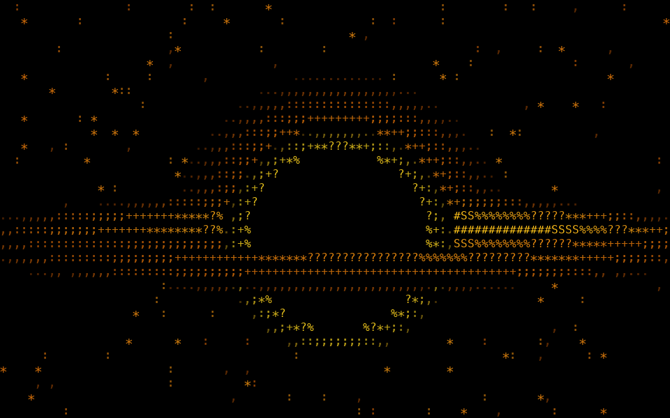

<p align="center">
  
</p>

<h1 align="center">bh</h1>

<p align="center">ASCII black hole in your terminal.</p>



```sh
cargo install --git https://github.com/Pat-1337/bh
bh
```

| Option    | Description                    |
| --------- | ------------------------------ |
| `ZOOM`    | zoom level, 5-80 (default 20)  |
| `--clean` | hide background stars          |
| `--black` | force a black background       |
| `--once`  | render a single frame and exit |
| `--help`  | show usage                     |

Press `q`, `Esc` or `Ctrl+C` to quit.
